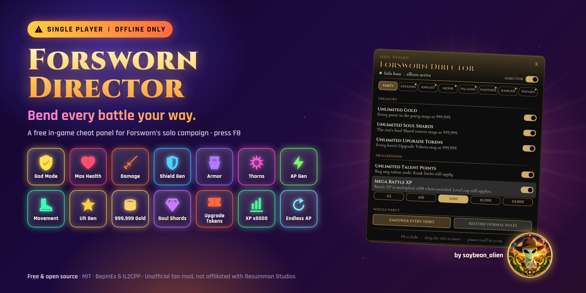
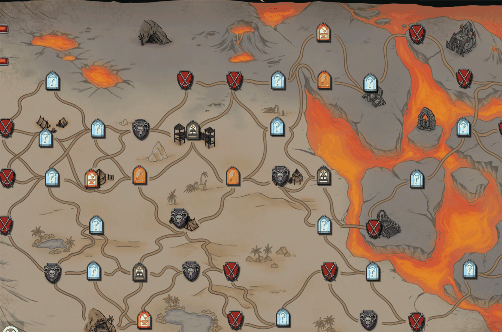

# Forsworn Director

An in-game cheat panel for **Forsworn**'s solo campaign. Press **F8** and bend every battle your way: god mode, endless action points, +20 stat boosts per hero, unlimited gold, Soul Shards, Upgrade Tokens and talent points, and up to x5,000 battle XP.

> [!CAUTION]
> ## SINGLE PLAYER | OFFLINE ONLY
> This mod is for **single-player and offline play only**. Do **not** use it in co-op or any multiplayer session.
> Cheating in co-op ruins the game for other players and **can get you banned by the developer**. It may also break
> Steam's rules; we don't know whether Valve would act on it, so **don't risk your account**.
> The mod pauses all of its effects when it detects another player, but don't rely on that:
> **switch the Director off (or uninstall it) before you join or host co-op.**



## Features

**Party page**
- **Unlimited Gold:** every purse in the party stays at 999,999.
- **Unlimited Soul Shards:** the run's Soul Shard reserve stays at 999,999.
- **Unlimited Upgrade Tokens:** every hero's Upgrade Tokens stay at 999,999.
- **Unlimited Talent Points:** buy any talent node. Rank limits still come from the game.
- **Mega Battle XP:** battle XP is multiplied when the game awards it. One-click presets are x2, x10, x100, x1,000 and x5,000. Nothing is generated while idle, and the level cap still applies.
- **Empower every hero / Restore normal rules:** every class toggle on or off in one click.

**One page per class:** Assassin, Knight, Monk, Paladin, Panther, Ranger and Wizard.
- **God Mode:** damage is ignored and the hero can't fall.
- **Health Always Full**, **Endless Action Points**, **Endless Movement** and **Ultimate Always Ready**.
- **Stat boosts, +20 each,** toggled separately: Damage, Shield Generation, AP Generation, Armor, Ultimate Generation, Movement, Thorns and Max Health. They go through the game's own bonus system, so they show in the hero's stats as "Forsworn Director" and come off cleanly when switched off.
- A live readout of the hero's HP, AP, movement and ultimate while they're on the field, plus **All on / All off**.

**The panel**
- Styled after Forsworn's own UI, in the game's fonts.
- The status line says whether effects are active (green), paused and why (amber), or switched off.
- Drag the title bar to move it; it remembers where you put it. Clicks on the panel never reach the map or battlefield underneath.

## Install

You need **Forsworn on Windows (Steam)** and **BepInEx 6 for IL2CPP**.

1. Download **BepInEx 6 bleeding edge, Unity IL2CPP x64** (build 789 or newer) from [builds.bepinex.dev](https://builds.bepinex.dev/projects/bepinex_be). Pick the file named like `BepInEx-Unity.IL2CPP-win-x64-6.0.0-be.789+….zip`.
2. Extract it into the Forsworn folder, next to `Forsworn.exe` (Steam → Forsworn → Manage → Browse local files).
3. Start Forsworn once and wait at the main menu. The first launch takes a few minutes while BepInEx generates its files. Then quit.
4. Download `ForswornDirector-1.0.0.zip` from [Releases](../../releases) and extract it into the Forsworn folder. You should end up with `BepInEx/plugins/ForswornDirector/ForswornDirector.dll`.
5. Start a **single-player** run and press **F8**.

Everything starts switched off except the master switch; turn on what you want. Settings are saved in `BepInEx/config/soybean_alien.forsworn.director.cfg`. You can also change the panel hotkey there (`ToggleKey`).

**Uninstall:** delete `BepInEx/plugins/ForswornDirector`. To remove BepInEx too, delete `BepInEx`, `dotnet`, `doorstop_config.ini`, `winhttp.dll` and `.doorstop_version` from the game folder, or use Steam's "Verify integrity of game files".

## Good to know

- **Some changes are saved into your run.** Gold, Soul Shards, Upgrade Tokens and talent points are written into your save. Switching a toggle off later doesn't take them back. God mode, the endless toggles and the stat boosts only apply while they're on.
- **Back up your saves** before you start: copy `%USERPROFILE%\AppData\LocalLow\Resummon Studios LLC\Forsworn`.
- **Compatibility:** built and tested on Forsworn 1.0.21 with BepInEx 6.0.0-be.789. A game update can break it. If the panel won't open, check `BepInEx/LogOutput.log` and open an issue.
- **Tested** in the real game through a full campaign (Acts 1-3 and the final boss) and into a Hard two-hero playthrough, on a 2560x1440 display. Co-op hasn't been tested and isn't supported.

## Build from source

The project references BepInEx and the game's generated interop assemblies from the game's `BepInEx` folder, so run Forsworn with BepInEx once first.

```powershell
git clone https://github.com/soybean-alien/forsworn-director
cd forsworn-director
dotnet build ForswornDirector.csproj -c Release -o build\out -p:BepInExDir="<Forsworn folder>\BepInEx"
```

- `tools/DemoGif` re-records the demo from the real game.
- `tools/banner` renders the banner.

## Credits and AI disclosure
- Made by **soybean_alien**. Licensed under the **MIT License** (see [LICENSE](LICENSE)).
- [BepInEx](https://github.com/BepInEx/BepInEx) and [HarmonyX](https://github.com/BepInEx/HarmonyX). Forsworn Director is a BepInEx 6 IL2CPP plugin.
- Forsworn © Resummon Studios. Forsworn Director is an unofficial fan project and isn't affiliated with Resummon Studios.
- **AI disclosure:** Forsworn Director was designed with and written by **Claude Code (Anthropic, Claude Opus 5.5)**, building on an earlier prototype and crash fix by **OpenAI Codex**, directed and play-tested by the author, using the universal-modder toolkit. Every feature listed above was switched on and used in the real game, through a full campaign, before release.
