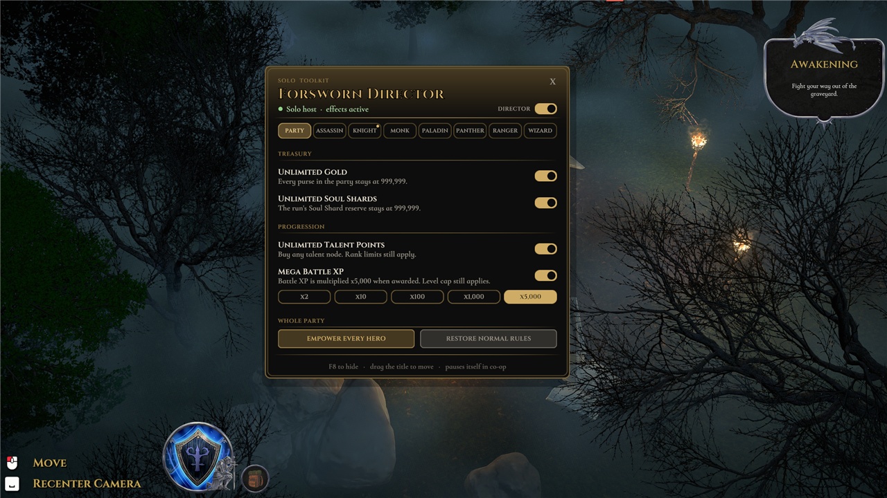

# Forsworn Director

A solo/offline toolkit for **Forsworn**, built as a BepInEx 6 IL2CPP plugin. Press **F8** in game to open the Director panel. It's a gold-trimmed overlay set in the game's own Cinzel and Cormorant fonts, so it looks like part of Forsworn's UI.



Every effect pauses itself automatically unless the game is offline or you are a solo host with no other players connected. It never touches co-op sessions, Steam inventory or real money.

## What it does

**Party page**
- **Unlimited Gold:** every purse in the party stays at 999,999.
- **Unlimited Soul Shards:** the run's Soul Shard reserve stays at 999,999.
- **Unlimited Upgrade Tokens:** every hero's Upgrade Tokens stay at 999,999.
- **Unlimited Talent Points:** buy any talent node. Rank limits still come from the game.
- **Mega Battle XP:** XP awarded by the game is multiplied. One-click presets are x2, x10, x100, x1,000 and x5,000; the config accepts any value from 2 to 5,000. Nothing is generated while idle, and the level cap still applies.
- **Empower every hero / Restore normal rules:** turn every class toggle on or off at once.

**One page per class** (Assassin, Knight, Monk, Paladin, Panther, Ranger, Wizard)
- God Mode, Health Always Full, Endless Action Points, Endless Movement, Ultimate Always Ready.
- **Stat boosts:** eight separate +20 toggles for Damage, Shield Generation, AP Generation, Armor, Ultimate Generation, Movement, Thorns and Max Health. They're added through the game's own bonus system, so they appear in the hero's stat breakdown as "Forsworn Director" and come off cleanly when switched off.
- A live readout of that hero's HP, AP, movement and ultimate charge while they're on the field, plus **All on / All off** buttons.

The status line under the title shows whether effects are active (green), paused and why (amber), or switched off. Drag the title to move the panel; its position is remembered.

## Install

1. Install [BepInEx 6 IL2CPP x64](https://builds.bepinex.dev/projects/bepinex_be) (build 789 or newer) into the Forsworn folder and launch the game once so it generates interop assemblies.
2. Copy `ForswornDirector.dll` to `Forsworn/BepInEx/plugins/`.
3. Start a single-player run and press **F8**.

Settings live in `BepInEx/config/soybean_alien.forsworn.director.cfg`. Settings from v0.1.x (`net.codex.forsworn.director.cfg`) are migrated automatically on first launch.

## Build from source

The project references BepInEx core and the game's generated interop assemblies from `..\BepInEx` (the game folder). Override `BepInExDir` if yours lives elsewhere:

```powershell
dotnet build ForswornDirector.csproj -c Release -o build\out -p:BepInExDir='D:\SteamLibrary\steamapps\common\Forsworn\BepInEx'
```

## Credits and AI disclosure
- Made by **soybean_alien**. Licensed under the **MIT License** (see [LICENSE](LICENSE)).
- [BepInEx](https://github.com/BepInEx/BepInEx) and [HarmonyX](https://github.com/BepInEx/HarmonyX). Forsworn Director is a BepInEx 6 IL2CPP plugin.
- Forsworn © Resummon Studios. Forsworn Director is an unofficial fan project and isn't affiliated with Resummon Studios.
- **AI disclosure:** Forsworn Director was designed with and written by **Claude Code (Anthropic, Claude Opus 5.5)**, building on an earlier prototype by OpenAI Codex, directed by the author, using the universal-modder toolkit. The panel, session detection, and the per-class stat toggles were tested in the real game on a solo run. Gold, talent and XP effects are wired to the same hooks but were not yet observed in combat or shops.
